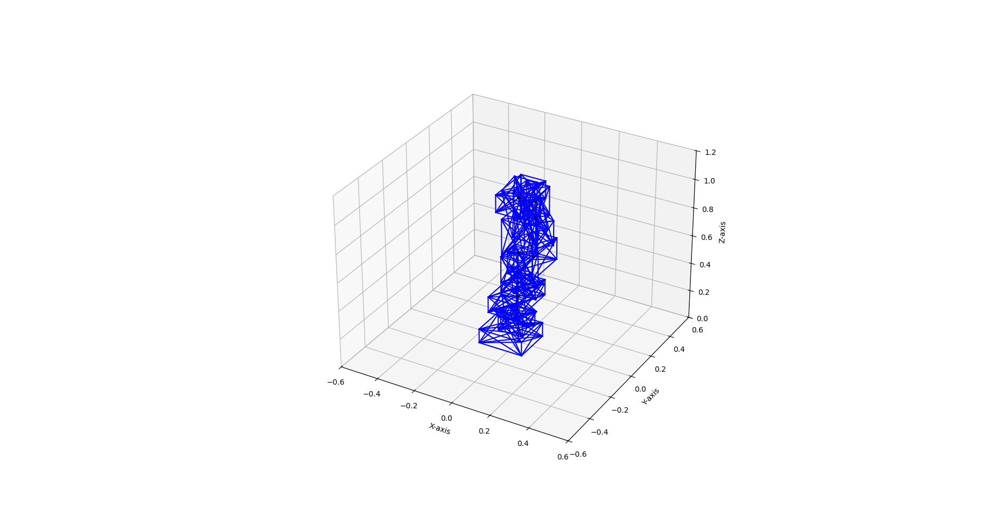

# Franka Robot Autonomy

**Kinematics · Collision Detection · Sampling-Based Motion Planning · MuJoCo Simulation**

A robotics software project exploring **collision-aware manipulation and joint-space motion planning** for the 7-DOF **Franka Emika Panda**. Developed in the context of CMU's Robot Autonomy coursework, this repository focuses on the implementation of geometric robot models, sampling-based planners, and trajectory execution in simulation.



### Project highlights

| Component | Implementation |
| --- | --- |
| **Robot kinematics** | Forward kinematics, end-effector transformations, geometric Jacobian, weighted damped-least-squares inverse kinematics (in `motion_planning/Franka.py`) |
| **Collision checking** | Oriented cuboid approximations for robot links and obstacles; **Separating Axis Theorem (SAT)** with face-normal and edge-cross-product axes |
| **RRT-based planning** | Single-tree RRT-Connect-style exploration in joint space; **0.30 rad** extension steps, **10%** goal bias, and up to **150** randomized collision-checked shortcut attempts |
| **Probabilistic roadmap** | **1,000** sampled collision-free configurations, joint-space neighbor threshold of **2.0 rad**, and collision-checked roadmap edges |
| **Trajectory execution** | Joint-space interpolation and gravity-compensated joint PD torque control in MuJoCo |
| **Controller prototypes** | Baseline gravity-compensation and joint-position control examples with fixed and oscillating board scenes; force and impedance controllers remain *unfinished starter templates* |

> **Scope:** This is a simulation-focused educational implementation, not a production-grade, continuously collision-certified planner or real-hardware controller. The edge checker evaluates discrete configurations along each edge. Full GUI simulation has not been automatically revalidated for this packaged version.

## Motion-planning demonstrations

The following videos accompany the original project work:

| Demonstration | Video |
| --- | --- |
| RRT path execution (without shortening) | [Watch original RRT execution](https://youtu.be/4ZZy9Jrrs1s) |
| RRT path after collision-checked shortcutting | [Watch shortened RRT execution](https://youtu.be/Hvsm1y_D1ek) |
| PRM-generated path execution | [Watch PRM execution](https://youtu.be/Cb0ACgUyGzM) |

## Repository layout

```text
Franka-Robot-Autonomy/
├── motion_planning/
│   ├── Franka.py                 # FK, Jacobian, IK, collision geometry / queries
│   ├── RobotUtil.py              # Transform utilities and SAT cuboid collision checks
│   ├── RRTQuery.py               # RRT exploration and path shortcutting
│   ├── PRMGenerator.py           # Roadmap construction
│   ├── PRMQuery.py               # Roadmap query and trajectory execution
│   ├── spawn_franka_start.py     # Visualize start joint configuration
│   └── spawn_franka_goal.py      # Visualize goal joint configuration
├── foundations/
│   ├── controls/                 # Course starter experiments (some TODOs unimplemented)
│   └── kinematics/               # Course FK / IK starter scaffolds (unimplemented)
├── franka_emika_panda/           # Licensed Franka MJCF robot & environment models
├── media/                        # Original collision geometry visualization
├── tests/                        # CPU-only geometry and kinematics checks
├── docs/                         # Implementation notes and publication guidance
└── requirements.txt
```

The fully implemented FK/Jacobian/IK source is in **`motion_planning/Franka.py`**, **not** `foundations/kinematics/Franka.py` (which is an unmodified exercise scaffold apart from file organization). Likewise, the force and impedance control callbacks under `foundations/controls/` still contain TODO placeholders.

## Installation

Tested/source files target Python 3 on Ubuntu with MuJoCo. Python 3.10+ is recommended; the requirements are broad compatibility ranges rather than a proven locked environment.

```bash
git clone https://github.com/YOUR_USERNAME/Franka-Robot-Autonomy.git
cd Franka-Robot-Autonomy
python3 -m venv .venv
source .venv/bin/activate
python -m pip install --upgrade pip
python -m pip install -r requirements.txt
```

The examples using a MuJoCo viewer need a working graphical desktop and OpenGL installation. For macOS, consult MuJoCo's `mjpython` guidance for scripts that open a viewer.

## Run examples

From the **repository root**:

```bash
# Geometry sanity checks (MuJoCo GUI not needed)
python -m unittest discover -s tests -v
python motion_planning/RobotUtil.py

# Visualize approximated robot-link collision boxes
python motion_planning/Franka.py

# RRT motion planning and MuJoCo playback
python motion_planning/RRTQuery.py

# PRM: construct the roadmap first (can be computationally intensive)
python motion_planning/PRMGenerator.py
python motion_planning/PRMQuery.py

# Optional: show start and goal configurations
python motion_planning/spawn_franka_start.py
python motion_planning/spawn_franka_goal.py

# Baseline control exercise with a fixed board (gravity compensation by default)
python foundations/controls/PandaArmControl_Part1.py
```

The PRM generator creates `motion_planning/myPRM.p`, a local **pickle** artifact consumed by `PRMQuery.py`. The original precomputed pickle is deliberately not distributed. **Only unpickle files you generated locally or otherwise trust.** Generated roadmaps, force CSVs, logs, and Python caches are ignored by Git.

## Technical approach

1. **Model** the Franka links using rigid transforms and obtain joint/end-effector poses and Jacobians.
2. **Approximate** the arm and environment with oriented collision cuboids.
3. **Reject** joint configurations and discretely sampled path segments failing the SAT collision check.
4. **Search** for a connected path using RRT exploration or a precomputed PRM.
5. **Refine and execute** candidate paths through waypoint shortcutting or interpolation and joint PD control in MuJoCo.

See [implementation notes](docs/IMPLEMENTATION_NOTES.md) for limitations and specifics.

## Background and attribution

This work was developed using course-provided scaffolding for **Robot Autonomy (16-662), Carnegie Mellon University**. The Franka robot's MJCF files were adapted in the course materials from **[MuJoCo Menagerie — Franka Emika Panda](https://github.com/google-deepmind/mujoco_menagerie/tree/main/franka_emika_panda)**. Its original Apache-2.0 license is preserved at [`franka_emika_panda/LICENSE`](franka_emika_panda/LICENSE). For third-party and course code attribution, see [`docs/ATTRIBUTION.md`](docs/ATTRIBUTION.md).

**Before making this repository public:** confirm that your course permits publishing modified assignment/starter files and solutions. Keeping the repository private until permission is verified is advisable.
